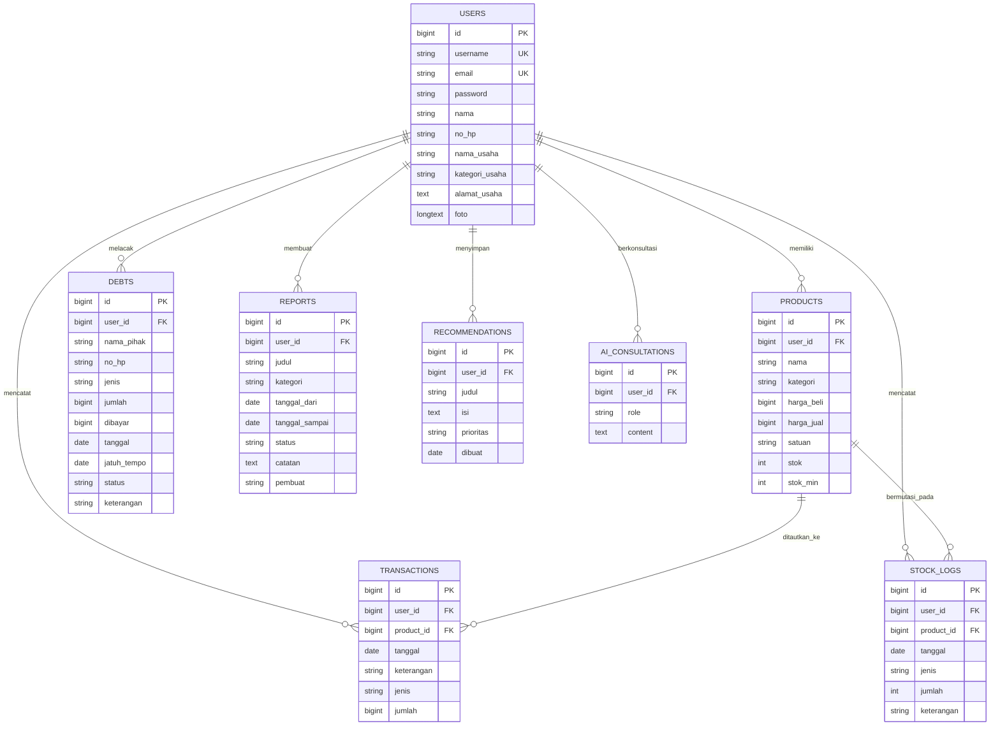

<div align="center">


# AlpetBizz

**Sistem Manajemen Arus Kas, Inventaris Stok Atomik, Buku Kasbon & Konsultan Bisnis AI untuk UMKM**

[](https://alpetbizz.vercel.app)
[](https://laravel.com)
[](https://www.php.net)
[](https://neon.tech)
[](https://tailwindcss.com)
[](https://ai.google.dev)
[](#pengujian-otomatis)

<p>
  <a href="https://alpetbizz.vercel.app"><strong>Buka Aplikasi Live &rarr;</strong></a>
  &nbsp;&middot;&nbsp;
  <a href="#fitur-utama">Fitur Utama</a>
  &nbsp;&middot;&nbsp;
  <a href="#arsitektur--keamanan">Arsitektur &amp; Keamanan</a>
  &nbsp;&middot;&nbsp;
  <a href="#skema-database-erd">Skema Database</a>
  &nbsp;&middot;&nbsp;
  <a href="#panduan-instalasi-lokal">Instalasi Lokal</a>
</p>

</div>

---

## Daftar Isi

1. [Tentang Proyek](#tentang-proyek)
2. [Fitur Utama](#fitur-utama)
3. [Teknologi yang Digunakan](#teknologi-yang-digunakan)
4. [Arsitektur & Keamanan](#arsitektur--keamanan)
5. [Skema Database (ERD)](#skema-database-erd)
6. [Struktur Direktori](#struktur-direktori)
7. [Daftar Route Aplikasi](#daftar-route-aplikasi)
8. [Panduan Instalasi Lokal](#panduan-instalasi-lokal)
9. [Pengujian Otomatis](#pengujian-otomatis)
10. [Deployment Produksi](#deployment-produksi)
11. [Tim Pengembang](#tim-pengembang)
12. [Lisensi](#lisensi)

---

## Tentang Proyek

**AlpetBizz** adalah aplikasi web manajemen operasional dan keuangan berbasis **Laravel 13** yang dirancang khusus untuk pelaku **UMKM dan toko kelontong**. Aplikasi ini menyatukan pencatatan transaksi kas harian, katalog produk, mutasi stok gudang secara atomik, pembukuan kasbon (hutang & piutang), pelaporan grafik bulanan, hingga **Konsultan Bisnis berbasis Google Gemini AI** dalam satu ruang kerja privat (*multi-tenant*).

Seluruh modul terhubung pada satu sumber data yang konsisten: ketika pengguna mencatat transaksi, mengubah stok, atau melunasi cicilan kasbon, seluruh indikator kinerja di dashboard, radar stok kritis, laporan bulanan, hingga konteks analisis AI ikut diperbarui secara langsung.

> **Proyek Mata Kuliah Pemrograman Web (Semester 3)** — Dibangun dengan standar rekayasa perangkat lunak modern mencakup isolasi multi-tenant anti-IDOR, *atomic database transactions*, *automated feature testing*, dan deployment cloud serverless.

---

## Fitur Utama

| Modul | Route | Deskripsi Fungsionalitas |
| :--- | :--- | :--- |
| **Landing Page & Autentikasi** | `/login`, `/register`, `/logout` | Halaman pengenalan interaktif (*sticky curtain parallax*, *overlapping scroll slabs*, *velocity marquee*, visual 3D) dengan modal login/registrasi terpadu, validasi kata sandi kuat, dan proteksi *rate limiting*. |
| **Dashboard Eksekutif** | `/dashboard` | Ringkasan *real-time* laba bersih, net profit margin, kesehatan stok, valuasi aset gudang (modal, nilai jual, potensi laba), target omzet vs *Break-Even Point* (BEP), dan alokasi omzet per kategori. |
| **Katalog Produk** | `/produk` | CRUD data SKU lengkap dengan harga beli, harga jual, satuan, batas stok minimum, validasi proteksi `harga_jual >= harga_beli`, serta kalkulasi margin per produk. |
| **Mutasi Stok Atomik** | `/stok` | Pencatatan stok masuk/keluar melalui `StockMovementService` menggunakan transaksi database terkunci (*pessimistic lock*), anti stok minus, serta kalkulasi ulang (*reversal*) otomatis saat log diedit atau dihapus. |
| **Arus Kas & Transaksi** | `/transaksi` | Pencatatan pemasukan dan pengeluaran harian yang dapat ditautkan ke produk/SKU tertentu, dilengkapi filter periode, pencarian, dan ringkasan saldo otomatis. |
| **Buku Kasbon (Hutang & Piutang)** | `/hutang-piutang` | Pelacakan piutang pelanggan maupun hutang supplier, pencatatan pembayaran cicilan bertahap, deteksi jatuh tempo, dan pembaruan status otomatis (`Belum Lunas` &rarr; `Cicilan` &rarr; `Lunas`). |
| **Laporan & Grafik Bulanan** | `/laporan` | Visualisasi tren pemasukan dan pengeluaran bulanan interaktif menggunakan **Chart.js** serta pencatatan arsip evaluasi laporan berkala. |
| **Rekomendasi Bisnis** | `/rekomendasi` | Analisis otomatis produk terlaris, radar peringatan stok kritis/menipis, dan manajemen daftar rekomendasi tindakan operasional. |
| **Konsultan Bisnis AI** | `/konsultasi-ai` | Antarmuka chat interaktif terhubung ke **Google Gemini API** (`GeminiBusinessAdvisorService`) yang otomatis menyertakan *snapshot* data live toko (omzet, margin, stok kritis, produk terlaris, dan kasbon) sebagai konteks saran bisnis. |
| **Profil & Pengaturan Usaha** | `/profil` | Pengelolaan identitas pemilik, informasi usaha (nama, kategori, alamat), unggah foto profil, dan pembaruan kata sandi terverifikasi. |

---

## Teknologi yang Digunakan

| Kategori | Teknologi |
| :--- | :--- |
| **Backend Framework** | PHP 8.3+, Laravel Framework 13.x |
| **Frontend & UI/UX** | Blade Templating, Tailwind CSS, Custom Dark Bento UI, Vanilla JS (SPA Navigation, Parallax & Velocity Scroll), Chart.js, SweetAlert2, Google Fonts (Poppins) |
| **Database** | PostgreSQL (Neon Cloud untuk produksi), SQLite / MySQL (pengembangan lokal) |
| **Integrasi AI** | Google Gemini API (`gemini-flash-lite-latest`) melalui Laravel HTTP Client |
| **Hosting & Deployment** | Vercel Serverless PHP (`vercel-php@0.7.4`, Region `sin1` Singapura) |
| **Testing & Code Quality** | PHPUnit 12, Laravel Pint (PSR-12 / Laravel style), Composer Security Audit |

---

## Arsitektur & Keamanan

AlpetBizz dirancang dengan perhatian tinggi pada keamanan data pengguna, konsistensi transaksi, dan kecepatan akses:

- **Isolasi Multi-Tenant Anti-IDOR:** Seluruh tabel operasional (`products`, `transactions`, `stock_logs`, `debts`, `reports`, `recommendations`, `ai_consultations`) memiliki relasi `user_id` dan di-*scope* ketat pada setiap query serta aksi ubah/hapus sehingga akun satu tidak dapat mengakses atau memodifikasi data milik akun lain.
- **Mutasi Stok Atomik (`StockMovementService`):** Operasi perubahan stok dibungkus dalam `DB::transaction()` dengan `lockForUpdate()` untuk mencegah *race condition* dan stok negatif.
- **Proteksi Autentikasi & Rate Limiting:**
  - Pembatasan percobaan login (`throttle:auth`) dan kuota pengiriman pesan AI (`throttle:ai-consultation`).
  - Endpoint `/logout` hanya menerima metode `POST` ber-CSRF token (menolak `GET` dengan `405 Method Not Allowed`).
  - Hashing kata sandi menggunakan Bcrypt (`BCRYPT_ROUNDS=12`) dan validasi kata sandi minimal 8 karakter kombinasi huruf & angka saat registrasi.
- **HTTP Security Headers (`AddSecurityHeaders`):** Menghapus header `X-Powered-By` dan menerapkan `X-Frame-Options: DENY`, `X-Content-Type-Options: nosniff`, `Referrer-Policy`, `Permissions-Policy`, serta `Strict-Transport-Security` (HTTPS).
- **Optimasi Performa Cloud:** Serverless PHP Vercel di-pin ke region **Singapura (`sin1`)** satu wilayah dengan database **Neon PostgreSQL**, dilengkapi indeks komposit database, konsolidasi query dashboard (3 query utama), serta navigasi SPA mulus tanpa muat ulang penuh.
- **Audit Dependensi Bersih:** `composer audit` terverifikasi **0 security advisories**.

---

## Skema Database (ERD)



---

## Struktur Direktori

```text
Project_PemWeb/
├── api/
│   └── index.php                        # Serverless entrypoint untuk Vercel PHP
├── app/
│   ├── Http/
│   │   ├── Controllers/
│   │   │   ├── AiConsultationController.php
│   │   │   ├── AuthController.php
│   │   │   ├── DashboardController.php
│   │   │   ├── DebtController.php
│   │   │   ├── ProductController.php
│   │   │   ├── ProfileController.php
│   │   │   ├── RecommendationController.php
│   │   │   ├── ReportController.php
│   │   │   ├── StockController.php
│   │   │   └── TransactionController.php
│   │   └── Middleware/
│   │       ├── AddSecurityHeaders.php
│   │       ├── EnsureAppInitialized.php
│   │       └── EnsureUserIsAuthenticated.php
│   ├── Models/                          # 8 Eloquent Models (User, Product, Transaction, dll.)
│   └── Services/
│       ├── GeminiBusinessAdvisorService.php  # Integrasi Gemini API + store snapshot builder
│       └── StockMovementService.php          # Mutasi & reversal stok atomik terkunci
├── database/
│   ├── factories/                       # Model factories untuk pengujian otomatis
│   ├── migrations/                      # 14 file migrasi skema & indeks komposit
│   └── seeders/                         # DatabaseSeeder & ProductSeeder
├── public/
│   ├── assets/
│   │   ├── css/                         # login.css, animations.css
│   │   └── js/                          # login.js, animations.js, spa.js, profil.js
│   └── img/                             # logo.png, hero-3d.webp
├── resources/views/                     # Blade templates (Landing Page + 9 halaman workspace)
├── routes/
│   └── web.php                          # Definisi seluruh route publik & terproteksi
├── tests/Feature/                       # 12 PHPUnit feature test suites (36 tests)
├── composer.json
└── vercel.json                          # Konfigurasi deployment & routing Vercel (sin1)
```

---

## Daftar Route Aplikasi

### Route Publik
| Method | Endpoint | Middleware | Keterangan |
| :--- | :--- | :--- | :--- |
| `GET` | `/` | — | Redirect otomatis ke `/login` |
| `GET` | `/login` | — | Landing Page & Modal Autentikasi |
| `POST` | `/login` | `throttle:auth` | Proses Login & Registrasi akun |
| `GET` | `/register` | — | Redirect ke `/login?tab=register` |
| `POST` | `/logout` | `web` (CSRF) | Mengakhiri sesi pengguna |

### Route Terproteksi (`auth.custom`)
| Method | Endpoint | Keterangan |
| :--- | :--- | :--- |
| `GET` | `/dashboard` | Ringkasan analitik & metrik bisnis |
| `GET` / `POST` | `/produk` | Manajemen katalog produk (CRUD) |
| `GET` / `POST` | `/stok` | Mutasi stok masuk/keluar atomik |
| `GET` / `POST` | `/transaksi` | Buku kas pemasukan & pengeluaran |
| `GET` / `POST` | `/hutang-piutang` | Buku kasbon, cicilan & pelunasan |
| `GET` / `POST` | `/laporan` | Grafik tren bulanan & catatan laporan |
| `GET` / `POST` | `/rekomendasi` | Analisis produk terlaris & rekomendasi bisnis |
| `GET` | `/konsultasi-ai` | Ruang chat Konsultan Bisnis AI |
| `POST` | `/konsultasi-ai/kirim` | Kirim pertanyaan ke Gemini AI (`throttle:ai-consultation`) |
| `POST` | `/konsultasi-ai/reset` | Bersihkan riwayat percakapan AI |
| `GET` / `POST` | `/profil` | Pengaturan profil pemilik & usaha |

---

## Panduan Instalasi Lokal

### Prasyarat
- **PHP** `>= 8.3` (dengan ekstensi `pdo_sqlite` / `pdo_pgsql` / `pdo_mysql`, `mbstring`, `openssl`, `curl`)
- **Composer** `>= 2.x`
- **Node.js** `>= 18` *(opsional, untuk tooling frontend lokal)*
- **Google Gemini API Key** *(opsional, hanya diperlukan jika ingin mengaktifkan respon live fitur Konsultan AI)*

### Langkah Instalasi

1. **Clone repository**
   ```bash
   git clone https://github.com/ekawahyu-project/Project_PemrogramanWeb.git
   cd Project_PemrogramanWeb
   ```

2. **Install dependensi PHP**
   ```bash
   composer install
   ```

3. **Salin konfigurasi environment & buat App Key**
   ```bash
   cp .env.example .env
   php artisan key:generate
   ```

4. **Konfigurasi Database & Gemini API di file `.env`**
   - Secara default, aplikasi siap berjalan langsung menggunakan **SQLite** (`database/database.sqlite`). Untuk MySQL atau PostgreSQL, sesuaikan variabel `DB_CONNECTION`, `DB_HOST`, `DB_PORT`, `DB_DATABASE`, `DB_USERNAME`, dan `DB_PASSWORD`.
   - Untuk mengaktifkan Konsultan AI, isi kunci API Gemini Anda:
     ```env
     GEMINI_API_KEY=your_google_gemini_api_key
     GEMINI_MODEL=gemini-flash-lite-latest
     ```

5. **Jalankan migrasi & seeder data awal**
   ```bash
   touch database/database.sqlite
   php artisan migrate --seed
   ```
   *(Di Windows PowerShell, gunakan `New-Item -ItemType File -Force database/database.sqlite` sebagai pengganti `touch`.)*

6. **Jalankan server pengembangan lokal**
   ```bash
   php artisan serve
   ```
   Buka browser dan akses **`http://127.0.0.1:8000`**.

### Akun Demo Default (Lokal / Seeder)
Setelah menjalankan `php artisan migrate --seed`, Anda dapat langsung masuk menggunakan akun contoh atau mendaftar akun usaha baru melalui tombol **Daftar Akun**:

| Field | Nilai |
| :--- | :--- |
| **Username** | `admin` |
| **Email** | `admin@gmail.com` |
| **Kata Sandi** | `admin123` |

---

## Pengujian Otomatis

Seluruh fitur inti dan batas keamanan aplikasi diverifikasi menggunakan **PHPUnit** (36 feature tests, 325 assertions) yang mencakup autentikasi, seluruh modul CRUD, konsistensi mutasi stok atomik, simulasi respon Gemini AI, isolasi multi-tenant anti-IDOR, rate limiting, dan security headers.

```bash
# Menjalankan seluruh test suite
php artisan test --compact

# Memeriksa & merapikan standar kode PHP (Laravel Pint)
vendor/bin/pint

# Audit kerentanan keamanan dependensi Composer
composer audit
```

**Cakupan Test Suite (`tests/Feature/`):**
- `AuthTest` &bull; `DashboardControllerTest` &bull; `ProductControllerTest` &bull; `StockControllerTest`
- `TransactionControllerTest` &bull; `DebtControllerTest` &bull; `ReportControllerTest` &bull; `RecommendationControllerTest`
- `AiConsultationControllerTest` &bull; `ProfileControllerTest` &bull; `SecurityHardeningTest`

---

## Deployment Produksi

Aplikasi ini telah di-deploy dan berjalan langsung di lingkungan produksi menggunakan arsitektur serverless:

- **Live URL:** [https://alpetbizz.vercel.app](https://alpetbizz.vercel.app)
- **Compute:** Vercel Serverless PHP (`api/index.php` via `vercel-php@0.7.4`, region `sin1` Singapura)
- **Database:** Neon Serverless PostgreSQL (region Singapura)
- **Perintah Deploy Ulang:**
  ```bash
  vercel --prod
  ```

---

## Tim Pengembang

Proyek ini dikembangkan bersama untuk memenuhi tugas mata kuliah **Pemrograman Web**:

| Kontributor | Repository / Identitas |
| :--- | :--- |
| **Eka Wahyu Maulidan** | [@ekawahyu-project](https://github.com/ekawahyu-project) |
| **Zacky Al Ghifari** | `Zackyalghfr` |
| **Mochammad Alfan Rizqi Abdilah** | Kontributor |
| **Ahmad Zaki Andika** | `Ahmadzaki15` |
| **Aloyys** | `Aloyys` |

---

## Lisensi

Proyek ini dilisensikan di bawah lisensi [MIT License](https://opensource.org/licenses/MIT).
